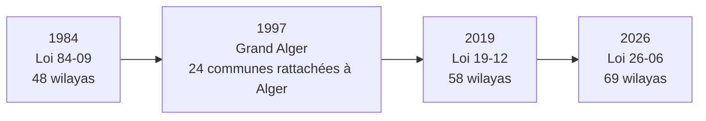

# Découpage administratif de l’Algérie — communes, daïras et wilayas (1984 · 2019 · 2026)

Couche géographique des **1 541 communes** d’Algérie, rattachées à leur daïra et à leur wilaya selon les **trois découpages successifs** fixés par le Journal officiel :

| Découpage | Texte | Wilayas | Communes |
|---|---|---|---|
| **1984** | Loi n° 84-09 du 4 février 1984 (+ rectificatif) | 48 | 1 541 |
| **2019** | Loi n° 19-12 du 11 décembre 2019 | 58 | 1 541 |
| **2026** | Loi n° 26-06 du 4 avril 2026 | 69 | 1 541 |

Chaque rattachement a été **vérifié contre le texte du JO** (copies jointes dans [`sources/jo/`](sources/jo/)), et chaque correction est tracée dans [`controle/journal_corrections_JO.csv`](controle/journal_corrections_JO.csv).

> ⚠️ **Ce jeu de données n’est pas une publication officielle.** Il s’agit d’un travail de compilation à partir des textes du JO. En cas de doute, seul le Journal officiel fait foi.

---

## Sommaire

1. [Contenu du dépôt](#1-contenu-du-dépôt)
2. [Les textes officiels utilisés](#2-les-textes-officiels-utilisés)
3. [Historique du découpage](#3-historique-du-découpage)
4. [Dictionnaire des données](#4-dictionnaire-des-données)
5. [Les identifiants : IdCommune, CdCommune et CdCommune_Gen](#5-les-identifiants)
6. [Méthode et contrôles](#6-méthode-et-contrôles)
7. [Fiabilité et limites connues](#7-fiabilité-et-limites-connues)
8. [Utilisation avec PostgreSQL / PostGIS](#8-utilisation-avec-postgresql--postgis)
9. [Contribuer](#9-contribuer)
10. [Licence et citation](#10-licence-et-citation)

---

## 1. Contenu du dépôt

```
algeria-admin-boundaries/
├── README.md                  ← ce fichier
├── CHANGELOG.md               ← historique des corrections
├── docs/
│   └── CdCommune_Gen.md       ← explication détaillée du code généré
├── sources/jo/                ← les PDF du Journal officiel utilisés
├── data/
│   ├── communes/              ← 1 541 communes (couche principale)
│   ├── daira_actuelle/        ← daïras actuelles (agrégation des communes)
│   ├── wilaya_1984/           ← 48 wilayas
│   ├── wilaya_2019/           ← 58 wilayas
│   └── wilaya_2026/           ← 69 wilayas
├── controle/                  ← fichiers de vérification et de traçabilité
└── sql/                       ← schéma PostgreSQL et requêtes d’exemple
```

Tous les fichiers sont en **UTF-8**, système de coordonnées **WGS 84 (EPSG:4326)**.

Les couches de daïras et de wilayas sont obtenues par **fusion des polygones de communes** : elles sont donc parfaitement emboîtées avec la couche communale.

### Fichiers de contrôle (`controle/`)

| Fichier | Contenu |
|---|---|
| `journal_corrections_JO.csv` | Chaque correction apportée, avec la valeur avant/après et le texte qui la justifie |
| `noms_a_verifier.csv` | Les 272 noms de communes non encore confirmés par un JO, avec le nom trouvé dans le JO le plus récent |
| `renommages_JO_loi_26-06.csv` | Les noms remplacés par la graphie de la loi 26-06 |
| `correspondance_IdCommune.csv` | Passage de l’ancien au nouvel `IdCommune` |

---

## 2. Les textes officiels utilisés

| Fichier (`sources/jo/`) | Texte | Ce qu’il apporte |
|---|---|---|
| `1984-02-07_JO006_loi_84-09.pdf` | Loi n° 84-09 du 4 février 1984 relative à l’organisation territoriale du pays | Les 48 wilayas et la liste de leurs communes |
| `1984-05-08_JO019_loi_84-09_rectificatif.pdf` | Rectificatif de la loi 84-09 | Le total passe à 1 541 communes ; Mascara compte 47 communes (Guettena et El Mamounia séparées) |
| `1991-09-04_JO041_decret_91-306_dairas.pdf` | Décret exécutif n° 91-306 du 24 août 1991 fixant la liste des communes animées par chaque chef de daïra | Les daïras, leurs sièges et leurs communes |
| `1997-08-06_JO051_decret_97-292_grand_alger.pdf` | Décret présidentiel n° 97-292 du 2 août 1997 fixant l’organisation administrative du Gouvernorat du Grand Alger | Les 57 communes d’Alger et leurs 12 circonscriptions |
| `2019-12-18_JO078_loi_19-12.pdf` | Loi n° 19-12 du 11 décembre 2019 | Création des wilayas 49 à 58 |
| `2026-04-05_JO025_loi_26-06.pdf` | Loi n° 26-06 du 4 avril 2026 | Création des wilayas 59 à 69 |

Les PDF proviennent du site officiel [joradp.dz](https://www.joradp.dz) (édition en traduction française).

---

## 3. Historique du découpage



**1984 — 48 wilayas.** La loi 84-09 fixe le découpage de référence.

**1997 — Grand Alger.** L’ordonnance n° 97-14 du 31 mai 1997 rattache à la wilaya d’Alger 24 communes prises à trois wilayas voisines :

| Wilaya d’origine | Communes rattachées à Alger |
|---|---|
| Blida (09) | Birtouta, Ouled Chebel, Sidi Moussa, Tessala El Merdja |
| Boumerdès (35) | Aïn Taya, Bordj El Bahri, El Marsa, Harraoua, Reghaïa, Rouiba |
| Tipaza (42) | Aïn Benian, Baba Hassen, Cheraga, Douera, Draria, El Achour, Khraïssia, Mâalma, Ouled Fayet, Rahmania, Saoula, Souidania, Staoueli, Zeralda |

C’est pourquoi une commune comme **El Achour** a le code wilaya `42` (Tipaza) en 1984 et `16` (Alger) en 2019 et 2026.

**2019 — 58 wilayas.** La loi 19-12 érige 10 wilayas nouvelles (codes 49 à 58), chacune issue d’une seule wilaya mère :

| Code | Wilaya | Wilaya mère |
|---|---|---|
| 49 | Timimoun | Adrar |
| 50 | Bordj Badji Mokhtar | Adrar |
| 51 | Ouled Djellal | Biskra |
| 52 | Béni Abbès | Béchar |
| 53 | In Salah | Tamanrasset |
| 54 | In Guezzam | Tamanrasset |
| 55 | Touggourt | Ouargla |
| 56 | Djanet | Illizi |
| 57 | El M’Ghair | El Oued |
| 58 | El Meniaa | Ghardaïa |

**2026 — 69 wilayas.** La loi 26-06 crée 11 wilayas nouvelles (codes 59 à 69) :

| Code | Wilaya | Wilaya mère | Communes |
|---|---|---|---|
| 59 | Aflou | Laghouat | 12 |
| 60 | Barika | Batna | 8 |
| 61 | El Kantara | Biskra | 5 |
| 62 | Bir El Ater | Tébessa | 4 |
| 63 | El Aricha | Tlemcen | 4 |
| 64 | Ksar Chellala | Tiaret | 6 |
| 65 | Aïn Oussera | Djelfa | 10 |
| 66 | Messaad | Djelfa | 8 |
| 67 | Ksar El Boukhari | Médéa | 21 |
| 68 | Bou Saâda | M’Sila | 23 |
| 69 | El Abiodh Sidi Cheikh | El Bayadh | 7 |

> La loi 26-06 ne donne **ni le numéro ni le nom** des nouvelles wilayas ; elle dit seulement que telles communes « constituent une wilaya ». Les codes 59 à 69 sont déduits de la numérotation des articles de la loi 84-09 (l’article *N* correspond à la wilaya *N − 4* ; les articles 52 bis 10 à 52 bis 20 donnent donc les codes 59 à 69). Le nom retenu est celui de la première commune citée, qui est le chef-lieu.

---

## 4. Dictionnaire des données

Couche principale : `data/communes/` — une ligne par commune.

| Champ | Type | Description |
|---|---|---|
| `oid` | entier | Identifiant technique (1 à 1 541, dans l’ordre de `CdCommune_Gen_2026`) |
| `IdCommune` | texte | Clé lisible : code wilaya 2026 + nom (ex. `16_EL_ACHOUR`). Voir [§ 5](#5-les-identifiants) |
| `CdCommune` | texte | **Réservé au code officiel ONS** (vide pour l’instant) |
| `CdCommune_Gen_1984` | texte (6) | Code généré, découpage 1984. Voir [§ 5](#5-les-identifiants) |
| `CdCommune_Gen_2019` | texte (6) | Code généré, découpage 2019 |
| `CdCommune_Gen_2026` | texte (6) | Code généré, découpage 2026 |
| `LbCommune` | texte | Nom de la commune (graphie du JO le plus récent qui la cite) |
| `SrcLbCommune` | texte | Texte du JO qui confirme ce nom, ou « non vérifié au JO » |
| `LbCommune_AR` | texte | Nom en arabe (source non officielle, voir [§ 7](#7-fiabilité-et-limites-connues)) |
| `LbDaira_1991` | texte | Daïra selon le décret 91-306 (siège tel qu’écrit dans le JO) |
| `LbChefLieuDaira_1991` | texte | Commune chef-lieu de cette daïra |
| `LbDaira` | texte | Daïra actuelle (source non officielle) |
| `LbDaira_AR` | texte | Nom arabe de la daïra actuelle |
| `LbChefLieuDaira` | texte | Commune chef-lieu de la daïra actuelle |
| `CdWilaya_1984` / `LbWilaya_1984` | texte | Wilaya selon la loi 84-09 |
| `CdWilaya_2019` / `LbWilaya_2019` | texte | Wilaya selon la loi 19-12 |
| `CdWilaya_2026` / `LbWilaya_2026` | texte | Wilaya selon la loi 26-06 |

Les codes sont stockés en **texte** pour conserver le zéro initial (`01`, `090101`…).

---

## 5. Les identifiants

Le jeu de données comporte trois identifiants de commune, qui ont chacun un rôle différent.

### `IdCommune` — la clé lisible

Format : `<code wilaya 2026>_<NOM>`, nom en majuscules, sans accents, espaces et apostrophes remplacés par `_`.

```
01_ADRAR    16_EL_ACHOUR    68_BOU_SAADA    05_MENAA    68_MENAA
```

Il est unique et pratique pour les jointures, mais il **dépend du découpage et du nom** : si une commune change de wilaya, sa clé change (voir `controle/correspondance_IdCommune.csv`).

### `CdCommune` — le code officiel (vide)

Réservé au **code commune de l’ONS** (Office national des statistiques). Il est laissé vide tant qu’une source officielle n’est pas disponible, pour ne jamais mélanger un code inventé avec un code officiel.

### `CdCommune_Gen_<année>` — le code généré

Code à **6 chiffres**, construit de façon reproductible, **un par découpage** :

```
  WW     DD     CC
  │      │      └── rang de la commune dans sa daïra
  │      └───────── rang de la daïra dans sa wilaya
  └──────────────── code de la wilaya (selon l’année)
```

**Règles de numérotation :**

1. **Wilaya (`WW`)** : le code de la wilaya pour l’année concernée (`CdWilaya_1984`, `_2019` ou `_2026`).
2. **Daïra (`DD`)** : la daïra qui contient le **chef-lieu de wilaya** reçoit `01` ; les autres suivent par ordre alphabétique.
3. **Commune (`CC`)** : la **commune chef-lieu de daïra** reçoit `01` ; les autres suivent par ordre alphabétique.
4. Le tri alphabétique **ignore les accents et la casse** (« Aïn » et « Ain » sont classés pareil).

**Exemple — Blida :**

| Commune | Daïra | Code |
|---|---|---|
| Blida | Blida (daïra du chef-lieu → `01`) | `090101` |
| Bouarfa | Blida | `090102` |
| Boufarik | Boufarik (`02`) | `090201` |

**Les daïras utilisées selon l’année :**

| Code | Wilayas | Daïras |
|---|---|---|
| `CdCommune_Gen_1984` | Loi 84-09 | **Décret 91-306** (le texte officiel le plus proche de 1984) |
| `CdCommune_Gen_2019` | Loi 19-12 | Daïras actuelles |
| `CdCommune_Gen_2026` | Loi 26-06 | Daïras actuelles |

**La règle du code figé.** Un code n’a de valeur que s’il ne change pas. Les codes 2019 et 2026 ont donc été **générés une fois, puis figés** : toute correction ultérieure est **ajoutée en fin de liste**, sans renuméroter les autres communes. Cela explique quelques « trous » volontaires, par exemple :

- **Mansoura** (rattachée à tort à El Meniaa, puis corrigée vers Ghardaïa) a reçu `470801`, une nouvelle daïra ajoutée en fin de Ghardaïa. Hassi Fehal garde `580202` et `580201` n’est plus utilisé.
- **El Borma** (rattachée à tort à Ouargla, puis corrigée vers Touggourt) a reçu `550601`.

> ⚠️ **Le code généré n’est pas le code officiel ONS** et n’est **pas comparable d’une année à l’autre** : la même commune a en général un code différent en 1984, 2019 et 2026. Par exemple, El Achour : `420803` (1984), `160904` (2019 et 2026).

L’explication complète, avec tous les cas particuliers, se trouve dans [`docs/CdCommune_Gen.md`](docs/CdCommune_Gen.md).

---

## 6. Méthode et contrôles

1. **Appariement** de chaque commune avec la liste officielle de sa wilaya mère, par similarité de nom puis affectation optimale (une commune du JO ↔ une commune de la couche).
2. **Lecture des JO scannés** (1984, 1991, 1997) par reconnaissance de caractères, avec vérification visuelle des cas douteux sur l’image du JO.
3. **Contrôle des effectifs** : pour chaque wilaya, le nombre de communes de la couche doit être égal au nombre annoncé dans le texte.
4. **Contrôle géographique** : chaque wilaya doit former un territoire d’un seul tenant.

**Résultat des contrôles :**

| Découpage | Contrôle des effectifs |
|---|---|
| 1984 | 48 / 48 wilayas conformes à la loi 84-09 (avec son rectificatif) |
| 2019 | 18 / 18 wilayas citées par la loi 19-12 conformes |
| 2026 | 21 / 21 wilayas citées par la loi 26-06 conformes |

---

## 7. Fiabilité et limites connues

### Origine des noms de communes (`SrcLbCommune`)

| Source | Communes |
|---|---|
| JO 2026 (loi 26-06) | 404 |
| JO 2019 (loi 19-12) | 135 |
| JO 1997 (décret 97-292) | 51 |
| JO 1991 (décret 91-306) | 679 |
| **Non vérifié au JO** | **272** |

Les 272 noms non vérifiés sont listés dans `controle/noms_a_verifier.csv`. La plupart sont de simples variantes d’orthographe. Une dizaine correspondent à de **vrais changements de nom** postérieurs à 1991 (Hamma El Anasser → Belouizdad, Aïn Hsainia → Houari Boumediène, Taourirt → Ath Mansour…), dont le décret n’a pas encore été retrouvé.

### Daïras

- **`LbDaira_1991`** est officiel, mais **ancien** : des daïras ont été réorganisées depuis.
- **`LbDaira`** (actuelle) provient d’une **source non officielle**. Elle concorde avec le décret 97-292 pour Alger, sauf pour la circonscription de Sidi M’Hamed, créée après 1997.
- Deux daïras sont **à cheval sur deux wilayas** depuis les nouveaux découpages, en attendant un décret de réorganisation :
  - **Sebdou** : El Aricha et El Gor sont passées dans la wilaya d’El Aricha (63) en 2026.
  - **Mansourah (Ghardaïa)** : Hassi Fehal est passée dans la wilaya d’El Meniaa (58) en 2019.
- **Rouissat** (Ouargla) est absente du décret 91-306, bien que citée par les lois 84-09 et 19-12. Elle n’a donc pas de daïra de 1991 ; pour le code 1984, elle est rattachée à la daïra d’Ouargla.

### Noms en arabe

`LbCommune_AR` et `LbDaira_AR` proviennent d’une compilation communautaire, non vérifiée au JO arabe.

### Géométries

Les contours ne figurent pas dans le JO, qui ne publie que des listes. Ils proviennent du jeu de données d’origine. Quelques anomalies sont à vérifier, notamment un fragment isolé de 0,9 km² dans la commune d’Aïn Kerma (Oran).

---

## 8. Utilisation avec PostgreSQL / PostGIS

Le schéma complet est dans [`sql/schema.sql`](sql/schema.sql), et des requêtes d’exemple dans [`sql/exemples.sql`](sql/exemples.sql).

**Les communes d’une wilaya (2026) :**

```sql
SELECT "CdCommune_Gen_2026", "LbCommune", "LbDaira"
FROM immo.communes_algerie_global
WHERE "CdWilaya_2026" = '68'
ORDER BY "CdCommune_Gen_2026";
```

**Table de passage entre découpages :**

```sql
SELECT DISTINCT "CdWilaya_2019", "LbWilaya_2019", "CdWilaya_2026", "LbWilaya_2026"
FROM immo.communes_algerie_global
WHERE "CdWilaya_2019" <> "CdWilaya_2026"
ORDER BY 1, 3;
```

**Trouver la commune d’un point :**

```sql
SELECT "LbCommune", "LbWilaya_2026"
FROM immo.communes_algerie_global
WHERE ST_Contains(geom, ST_SetSRID(ST_MakePoint(3.0588, 36.7538), 4326));
```

---

## 9. Contribuer

Les contributions sont bienvenues, en particulier :

- **les décrets de changement de nom** des communes listées dans `controle/noms_a_verifier.csv` ;
- **les décrets modifiant le décret 91-306** (réorganisation des daïras) ;
- **le code officiel ONS** des communes, pour remplir `CdCommune` ;
- les corrections de géométrie.

Pour toute correction, merci d’indiquer **le texte du JO** qui la justifie (numéro, date, article). Une correction sans source officielle ne pourra pas être intégrée.

---

## 10. Licence et citation

- **Données** (`data/`) : [Open Database License (ODbL) 1.0](https://opendatacommons.org/licenses/odbl/1-0/).
  - Contours des communes : © les contributeurs d'OpenStreetMap — https://www.openstreetmap.org/copyright
  - Noms arabes et daïras actuelles : [othmanus/algeria-cities](https://github.com/othmanus/algeria-cities)
- **Documentation** : [CC BY 4.0](https://creativecommons.org/licenses/by/4.0/deed.fr)
- **Code** (`sql/`, `scripts/`) : MIT
- **Textes du Journal officiel** (`sources/jo/`) : documents publics de la République algérienne démocratique et populaire.

Pour citer ce jeu de données :

```
HAMIDAT Oussama, Découpage administratif de l’Algérie — communes, daïras et wilayas
(1984, 2019, 2026), version 1.0, 2026, https://github.com/oussamidat/algeria-admin-boundaries
```
